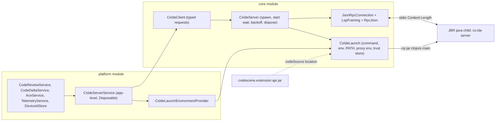

# Migrate the JetBrains plugin to the persistent `cs-ide` JSON-RPC server

Ticket: [CS-12077](https://app.clickup.com/t/9015696197/CS-12077). Reference implementation: `codescene-vscode` v0.29.0 (`181aa17`).
Protocol reference: `json-rpc-protocol.md` (CS-11628) and `cli/test/codescene/devtools/ide/e2e/README.md` in the `codescene` repo.

## Goal

Replace every in-process call into `com.codescene.ExtensionAPI` / `codescene.devtools.ide.DevToolsAPI` with requests to
one long-lived `cs-ide server` child process per IDE instance, spoken over JSON-RPC 2.0 on stdio. The server owns git
watching, baselines, the review queue and deltas; the plugin owns editors, UI and IDE-specific settings.

## Decisions

| Topic | Decision |
| --- | --- |
| Server artifact | The existing `codescene.extension:api` fat jar. It already embeds `clojure.main`, `codescene.cli.ide`, the server, `jsonrpc4clj` and JNA natives for every desktop OS/arch. No per-OS download, no Java or CLI install for users. |
| Java runtime | The IDE's own runtime: `System.getProperty("java.home")`. Every supported IDE (since build 243) runs JBR 21 or newer. |
| Client location | Kotlin, in the plugin's `core` module (`com.codescene.jetbrains.core.cli`). The jar supplies only the server classes, the `com.codescene.data.*` models and Jackson. |
| JSON library | The jar's Jackson, configured via `ExtensionAPI.createObjectMapper()`. No new dependency. |
| Framing | Hand-rolled LSP `Content-Length` framing (bytes, no `Content-Type`), ported from `feature/ide-daemon-json-rpc`. No lsp4j. |
| Branch | Fresh branch from `origin/master`; selected files from `feature/ide-daemon-json-rpc` (`c8f6b1c`) are ported and adapted. |
| Rollout | Hard cut-over in Phase 1. No in-process fallback. |
| Phasing | Four independently shippable phases. This spec covers all four; each phase gets its own implementation plan. |

## Launch contract

```text
<java.home>/bin/java[.exe]
  --enable-native-access=ALL-UNNAMED
  -Xmx2g
  [-Djavax.net.ssl.trustStore=<file> -Djavax.net.ssl.trustStoreType=PKCS12 -Djavax.net.ssl.trustStorePassword=<pw>]
  -cp <codescene.extension:api jar>
  clojure.main -m codescene.cli.ide server --threads <max(1, cpus/2)>
```

Verified locally on IntelliJ IDEA 2026.2.1 (JBR 25.0.3), Rider 2026.1.1 (JBR 25.0.2) and Temurin 17: each emits
`cs-ide/start` in 4-7 s and exits cleanly when stdin closes. The devtools CI publishes only after the packaged e2e suite
passes on JBR 21 (Windows, macOS) and JBR 25 (Linux).

- The jar is located with `ExtensionAPI::class.java.protectionDomain.codeSource.location`.
- A missing Java executable fails with an error naming the path.
- stdin carries only JSON-RPC frames; stdout is read only as JSON-RPC; stderr is logged and its last 4000 chars are kept
  for exit errors.
- The child environment is IntelliJ's `EnvironmentUtil.getEnvironmentMap()` (the user's shell environment) layered over
  the IDE process environment, so a Dock-launched macOS IDE still finds Homebrew tools, and a failed shell-environment
  read still leaves a usable `PATH`.
- The directory of Git4Idea's configured git executable is moved to the front of `PATH` (any existing occurrence is
  removed), because the server spawns `git` and must use the IDE's git. Entries are compared as trimmed, unquoted
  strings (case-insensitive on Windows), never parsed as paths, so quoted or unusual `PATH` entries cannot break the launch.
- Proxy: the server's HTTP client (`codescene.devtools.http-client`, `babashka.http-client` over `java.net.http`) reads
  only `https_proxy`/`HTTPS_PROXY`/`http_proxy`/`HTTP_PROXY`/`no_proxy`/`NO_PROXY`. When IntelliJ has a static HTTP proxy
  configured and no `http(s)_proxy` variable is already set (any case), the plugin sets `HTTPS_PROXY` and `HTTP_PROXY`
  for the child, plus `NO_PROXY` from the IDE's exceptions unless a `no_proxy` variable already exists. A lone
  `NO_PROXY`, common on corporate machines, does not suppress the IDE proxy. SOCKS, PAC and auto-detect are not translated.
- Certificates: IntelliJ's `CertificateManager` calls `SSLContext.setDefault` with its own trust manager, so today's
  in-process HTTPS calls trust whatever the IDE trusts. A child JVM would only trust its `cacerts`. The plugin therefore
  writes the IDE trust manager's accepted issuers to a PKCS12 trust store under the plugin's system directory and passes
  it with `javax.net.ssl.trustStore*`. If export fails, the child starts without it and the failure is logged.

## Architecture



The diagram is the request path used by ACE, telemetry and device id. Phase 2 deletes `CodeReviewService` and
`CodeDeltaService`. Workspace reviews are `cs-ide/reviewFiles` notifications, handled beside `CsIdeClient`.

### Wire rules

- Outbound keys are kebab-case. Inbound payloads are camelCase and are recursively kebab-cased (`([a-z0-9])([A-Z])` to
  `$1-$2`) before mapping onto the jar's kebab-case models. `nippyB64` becomes `nippy-b64`.
- Requests and notifications share one write lock, so messages leave in submission order.
- `$/cancelRequest` is sent when a caller cancels; the CLI does not abort work, the client just drops the result.
- JSON-RPC errors are `-32603` with free text. `CsIdeErrors` turns connection failures (`ConnectException`,
  `UnknownHostException`, `HttpConnectTimeoutException`, `HttpTimeoutException`) into `java.net.ConnectException` so
  `resolveAceFailureStatus` still reports OFFLINE; other messages pass through so the `"401"` check in
  `resolveAceErrorType` still works. Every blocking `CsIdeClient` call rethrows through `CsIdeErrors.unwrap`.
- `CsIdeUnavailableException` (server failed to start, crashed, or is in backoff) passes through unchanged, so ACE reports
  ERROR, not OFFLINE: a local server failure is not a network problem.
- `CsIdeClient` depends only on `fun interface CsIdeTransport`. `CsIdeServer` does not implement it; the platform service
  adapts it with `CsIdeTransport(server::request)`, and tests use `CsIdeTransport(connection::request)` against an
  in-process fake. The client can therefore be built and tested independently of launch and supervision.

### Supervision

- One server per IDE instance, owned by an application-level service. It starts lazily on the first request and waits
  up to 30 s for `cs-ide/start` (`{sha, version}`, logged; no strict SHA check because client and server ship in the
  same jar).
- A process exit or transport error fails every pending request. The next request respawns, subject to a backoff of
  1 s doubling to 30 s that applies after startup failures and unexpected exits. The backoff resets after a successful
  response. Calls during the cooldown fail fast.
- `close()` closes stdin, waits up to 3 s, then destroys `ProcessHandle.descendants()` and the process. This also kills
  the server's `git` children, on every OS.
- Dynamic plugin unload and IDE shutdown dispose the service.
- No request runs on the EDT. Telemetry builds its event (including the device id) inside its IO coroutine; the About tab
  loads the device id off the EDT.

## Phases

### Phase 1: transport and request methods

All eight in-process call sites move to requests; the classloader workaround goes away.

| Today | Phase 1 |
| --- | --- |
| `ExtensionAPI.review` (`CodeReviewService`) | `cs-ide/review` `{path, file-content, cache-path, repo-path}` |
| `ExtensionAPI.delta` (`CodeDeltaService`) | two `cs-ide/review` requests, then `cs-ide/delta` `{old-score, new-score}` with their `raw-score`s, mirroring `ExtensionAPI.delta` |
| `ExtensionAPI.fnToRefactor` x2 (`AceService`) | `cs-ide/fns-to-refactor` `{file-name, file-content, cache-path, preflight?, code-smells | delta-result}` |
| `ExtensionAPI.preflight` | `cs-ide/preflight` `{force}`; the client keeps the last response and sends it as `preflight` on `fns-to-refactor`, because the server fetches preflight over HTTP on every call when it is absent |
| `ExtensionAPI.refactor` | `cs-ide/refactor` `{fn-to-refactor, token?, skip-cache?}` |
| `ExtensionAPI.sendTelemetry` | `cs-ide/telemetry` `{event}` |
| `DevToolsAPI.deviceId` | `cs-ide/device-id` (result `deviceId`) |

- `BaseService.runWithClassLoaderChange` becomes `runTimed` (timing and logging only), and its classloader KDoc goes with
  it. `withPluginClassLoader` and its test are deleted. `DeviceIdStore` loses its classloader parameter and no longer caches a failed lookup, because the
  server may recover after a failed first start.
- Review and delta keep feeding today's caches, so the monitor, annotator and code vision are unchanged.
- The jar's live behaviour is pinned by `CsIdeLiveContractTest`, which replaces the three `ExtensionApi*` tests. That
  includes the code-health-rules review and delta test, which proves that `cs-ide/delta` without `repo-path` still honours
  rules (the rules are baked into the raw scores).
- JMH benchmarks call `CsIdeClient`, so CI measures the RPC path. They launch the server from the resolved
  `codescene.extension:api` jar, not the JMH fat jar, and report to a new benchmark series (`JetBrains Plugin - cs-ide
  RPC`) so the added IPC overhead does not trip `fail-on-alert` against the in-process history.
- The platform cut-over is smoke-tested with `make run-ide` in the same change that rewires the call sites, and again on
  the integration branch before the PR.
- Open risks that the Phase 1 smoke test checks: TLS-inspecting proxies (trust store export) and Dock-launched macOS (PATH).

### Phase 2: workspace review pipeline

The plugin stops calling `cs-ide/review` and `cs-ide/delta` for editor and path reviews. It sends `cs-ide/reviewFiles`
notifications and applies the server's notifications. `reviewFiles` has no JSON-RPC response; a client that waits for
one hangs. Do not send `baseline-revision`. The server resolves the merge-base itself (`.codescene/config.json`
`baseline_branch`, then `origin/HEAD`, `origin/main`, `origin/master`, local `main`, local `master`, else HEAD). The
plugin's reflog fallback is not consulted. This phase does not send `watchFiles`. Explicit `reviewFiles` still runs
for a repository that is not watched, because `enqueue-batch` computes analysis settings when no watch exists. Phase 3
adds the watch on the same result path.

Wire, checked against `ide_server.clj`, `workspace.clj`, `workspace/files.clj` and `e2e/wire_contract_test.clj`:

- Outbound keys are kebab-case: `{repo-root, files: [{rel-path, id?, content?}]}`. Omit `id` and `content` when they are
  absent. Do not send JSON null for either key.
- Inbound keys are camelCase (`repoRoot`, `gitBlobSha`, `oldGitBlobSha`, `newGitBlobSha`). Kebab-case them before
  mapping, as in Phase 1. The jar `Review` and `Delta` types have no blob-SHA properties. Unknown properties are
  ignored, so read the SHAs off the JSON before mapping those types.
- A live `Document` is a buffer, even when it is unmodified: `{id: <uuid>, rel-path, content: document.text}`. The hash
  is the UTF-8 git blob SHA of that string, which is the text the annotator and Code Vision display.
- A path with no `Document` is a disk file: `{rel-path}` only. The server then omits `id` on `fileReview` and
  `deltaReview`. `reviewFailed` always includes the `id` key, and it is null when the request had none.
- Buffer results match on `id`. The git-blob SHA must then equal the SHA of the buffer that is still current. A newer
  submit for that path, a closed editor, or an edited document drops the old id.
- Id-less results are the disk `reviewFiles` replies and, in Phase 3, the watch replies. Accept one only when its
  git-blob SHA equals the current bytes: the UTF-8 text of the loaded `Document` only when that document is unsaved,
  otherwise the raw file bytes on disk. Drop an id-less result with no SHA, except the null-result `deltaReview`
  that Phase 3 pairs with its review. A missing SHA does not by itself reject an id match.
- The git blob SHA is `sha1("blob " + byteLength + "\0" + bytes)` over the bytes the server hashed. Buffer content is
  UTF-8. Disk content is the raw file bytes.
- An unsupported extension produces neither a review nor `reviewFailed`. Keep filtering with `isFileSupported` /
  `isPathSupportedForReview`, and do not wait for a result per file.
- `reviewFailed` with an id completes that buffer submission and does not clear a newer submission for the path.
  `id: null` is logged and clears only the in-flight disk submit for that path.
- A `deltaReview` whose `result` is null is stored as a cache hit with a null delta, so Code Vision does not send the
  file again. `DeltaCacheService.getAll()` already hides null deltas, so the monitor does not list them.
- The monitor is fed from accepted `deltaReview`s written into the existing delta cache. `getCachedDelta` stops calling
  `getBranchCreationCommitCode`. There is no client-side baseline review and no `reviewBaseline`.
- `CsIdeClient.review`, `delta` and `reviewDelta` stay for the benchmarks and the Phase 1 live contract. The review
  path does not call them. ACE `fns-to-refactor` and `refactor` stay on requests and are refreshed from the presented
  review and delta.
- Every server notification, including those after `cs-ide/start`, is delivered to registered handlers. `cs-ide/start`
  still completes startup. Handlers run off the JSON-RPC reader thread and must not call `request` or `notify` on it.
  A dead session clears in-flight submits so the same content can be sent again after respawn.
- Progress UI follows `reviewProgress` (`{count, done, files}`, no repository). `count: 0` clears it. Remove the
  per-file `withBackgroundProgress` indicators from the review path. The title while work remains is
  `CodeScene analysis (N remaining)`.
- `PeriodicChangeListerService` keeps its 9s poll until Phase 3. It does not send `reviewFiles` again for a file whose
  current git-blob SHA was already accepted, so an unchanged poll does not raise `reviewProgress`. That is the fix for
  the progress indicator that Phase 1 saw every 6–9s. Phase 3 adds the watch beside the poller and Phase 4 deletes
  the poller; neither has to redesign the indicator.

`CachedReviewService` and `PathBasedReviewHandler` keep their entry points. Their review and delta bodies are replaced
by this pipeline. Phase 4 still deletes the baseline-resolution code; Phase 2 only stops calling it.

### Phase 3: watch and inventory

Plan: `docs/superpowers/plans/2026-10-13-phase3-watch-inventory.md`. Server behaviour below was checked against
`ide_server.clj`, `workspace.clj`, the `workspace/watch*` namespaces and the real server from the jar.

- One `watchFiles` per git root with `relative-paths` from the project's content roots inside it (`.` when a content root
  is the repo root, or contains it). Params are `{repo-root, relative-paths}`; never `baseline-revision`. A second
  `watchFiles` for a root replaces its roots, so the IDE sends one union per git root across all open projects and
  re-sends that full list whenever it changes. `stopWatchFiles` (`{repo-root}`) goes out when the last project using the
  root closes or is disposed; it never starts a server.
- `watchInventoryChanged` replaces the project's file set for that root wholesale; each project keeps only paths inside
  its own scope. A new watch always pushes an inventory (even an empty one) before its reviews, so after a restart the
  re-sent `watchFiles` brings a fresh push. `getWatchInventory` confirms: it is called when no push arrived within 10 s
  of a `watchFiles`, a scope change or a HEAD move, and after an empty push. It is not sent right after `watchFiles`,
  because the server handles both concurrently and can answer "not watched". A fetch result is dropped when a push for
  the root arrived after the fetch was issued.
- Watch results are id-less and go through the Phase 2 matcher; there is no second one. A result for a path the plugin
  never submitted is checked against the file's current bytes (unsaved document text when the editor buffer is dirty,
  else the raw bytes read from disk, not the VFS). An id-less result is dropped while a buffer for that path is in flight.
- A file restored to its baseline gets a `deltaReview` with `result: null` and no SHAs. It is accepted when the path's
  last accepted id-less `fileReview` is still waiting for its delta and the current bytes still hash to that review's
  SHA. The null delta then hides the file in the monitor.
- Detect a lost watch via `getWatchInventory` (`Repository is not watched`), including after the server stops a watch
  on its own (empty push). A lost root is re-watched at most once a minute.
- Session loss: re-send `watchFiles` for every wanted root when the next session starts, or retry 2 s after the loss
  and then after the server's remaining backoff (2–30 s) until it succeeds or no project wants a watch. No
  acknowledgement.
- HEAD moves (branch or revision of a git root): clear accepted pipeline state for that root and resubmit unsaved
  documents as buffers, then confirm the inventory. The server rebuilds its own merge-base and inventory.
- Inventory consumers: the monitor hides entries under a watched root that are neither in the inventory nor open, and
  re-includes inventory paths. While a project watches the poller's git root, the poller skips `StaleItemCleanup`.
- The server lists every untracked supported file; `Git4IdeaChangeLister` lists at most five per directory. That
  superset is accepted.
- Threads: notifications, session events, request completions, message-bus listeners and timers only enqueue. One
  coroutine per project and one for the application drain those queues on `Dispatchers.IO`; nothing runs on the
  reader thread or the EDT.
- Progress: the Phase 2 indicator stays the only one. An idle watch sends no `reviewProgress`.
- Keep `PeriodicChangeListerService` (its 9 s `submitPaths`) until the server inventory matches `Git4IdeaChangeLister`
  on the existing feature-branch scenarios. `WatchInventoryParityLiveTest` pins those scenarios against the real
  server; Phase 4 deletes the poller once it passes in CI.
- macOS JNA: keep the default JNA unpack (the Phase 1 spike passed with it; see "macOS go/no-go").

### Phase 4: legacy deletion

Plan: `docs/superpowers/plans/2026-10-14-phase4-legacy-deletion.md`.

- Git and file observation: `PeriodicChangeListerService`, `GitChangeObserver*`, `Git4IdeaChangeLister`, `VfsEventBridge`,
  `GitRepoStateListener`, `SavedFilesTracker*`, `CodesceneRepoFilesListener`, `GitIgnoreFilesListener`, `StaleItemCleanup`.
  The poller, `StaleItemCleanup` and the git listing go once `WatchLiveTest` and `WatchInventoryParityLiveTest` pass in
  #194 CI on Linux, Windows and macOS. The server handles `.gitignore`, `.codescene/*.json`, HEAD and ref changes; an
  unsaved buffer keeps its score until its next edit after a rules or ignore change.
- Monitor pruning stays with `InventoryMonitorSync`. A root that leaves the project's scopes syncs to its open files.
- Baseline: `MainLineBranchResolver`, `ClosestMainLineMergeBase`, `MainLineBranchContext`, `CodesceneRepoConfig`, the
  reflog helper, and the baseline parts of `Git4IdeaGitService` and `IGitService`. The server's merge-base candidates
  replace the plugin's, which also probed `develop`, `trunk`, `dev` and `development` and fell back to the reflog.
- Caches keyed by baseline: `BaselineReviewCacheService` and the CLI cache-name helpers. `isExpiredCliCacheEntry` stays;
  it prunes the ACE `.review-caches` directory.
- Disk submissions: `submitPaths`, `DiskSubmission` and `CachedReviewService.reviewByPath`. Files without an editor are
  reviewed only by the watch; a queued review whose editor closed is dropped.
- The consumer coroutines of `WorkspaceReviewService` and `CsIdeWatchService` survive a failing event.
- Keep editor-specific listeners (`FileEditorLifecycleListener`, dirty-buffer seeding), `FileChangeListener` (rename,
  move, delete) and project-content filters (`Git4IdeaGitService.isIgnored`, `getRepoRoot`, `getRepoRelativePath`).

## macOS go/no-go

JNA unpacks an unsigned `libjnidispatch.jnilib` to a temp directory. Whether the signed JBR `java` inside the `.app` may
load it depends on the IDE's entitlements. Only the file watcher (Phase 3) needs JNA. The spike script
`.github/cs-ide-macos-spike.clj` runs the launch command from an installed IDE's JBR, sends `cs-ide/watchFiles` for a
temporary git repo, edits a file and reports whether `cs-ide/fileReview` arrives and whether stderr shows a
`LinkageError`. It must pass on a Mac before Phase 3 starts. The script is written and checked on Windows in Phase 1;
the Mac run is a manual step owned by whoever coordinates the phase, and its result is recorded in the Phase 1 PR.

Result (2026-10-13): **go**. On macOS 26.4 (arm64) with IntelliJ IDEA 2026.2.3 and JBR 25.0.4, the spike passed both with
the default JNA unpack and with the IDE's bundled `lib/jna/aarch64/libjnidispatch.jnilib`, with no `LinkageError` and no
leftover process. The JBR is signed with `com.apple.security.cs.disable-library-validation`, which is why it may load
JNA's unsigned unpacked library. Phase 3 uses the default unpack and needs no extra JVM options. The spike scripts were
removed from the branch after the run.

## Testing

- Core unit tests over in-memory pipes: framing, JSON casing, connection (correlation, notifications, errors,
  cancellation, ordering, transport failure), launch (per-OS executable, missing Java, env and PATH merging, proxy env,
  argument order), trust store export, supervisor with a fake process (start timeout, crash, backoff, respawn, dispose),
  client against an in-process fake server, including errors surfacing from client calls as mapped exceptions.
- Benchmarks are verified by a short real `:benchmarks:jmh` run, not just by compiling the JMH jar.
- `CsIdeLiveContractTest` starts the real server from the resolved jar using the test JVM's Java, or `CS_IDE_JAVA` when
  set.
- Platform services keep their existing tests; services that called the jar statically get no new platform tests
  because their logic moves into core.
- Phase 2 adds unit tests for the git blob SHA, notification parsing, pipeline correlation, `reviewFiles` JSON and the
  delta-cache lookup, plus one live `reviewFiles` test against the jar. The platform cut-over is smoke-tested with
  `runIde`.
- Phase 3 adds unit tests for server session ids, the watch JSON, scopes, the IDE-wide watch registry, the per-project
  inventory state, watch-result acceptance and monitor sync, plus two live tests against the jar: `WatchLiveTest`
  (push before results, disk-byte SHA, idle without progress, null delta on restore, stop) and
  `WatchInventoryParityLiveTest`. The platform wiring is smoke-tested with `runIde`, split into checks the user makes in
  the IDE and checks the coordinator makes from the shell and `idea.log`.
- Phase 4 deletes tests with their classes, adds `ConsumerGuardTest` and the removed-root sync cases, and rewrites the
  pipeline tests that used disk submissions against watch results. It is smoke-tested with `runIde` twice: after the
  ungated deletions and after the gated ones.

## Non-goals

- Protocol hardening (`protocolVersion`, `watchFiles` acknowledgement, structured errors) belongs to the CLI.
- Shipping a native `cs-ide` binary or a jlinked JRE.
- Any change to ACE token storage (`AceAuthTokenStore` / `PasswordSafe`).
