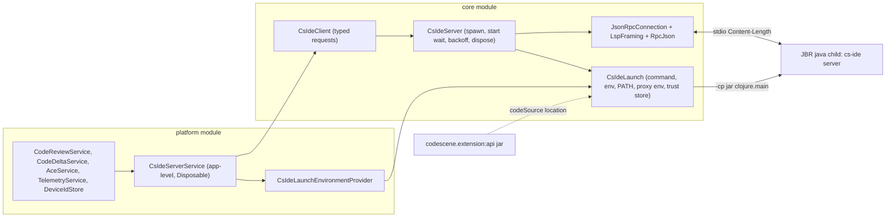

# Migrate the JetBrains plugin to the persistent `cs-ide` JSON-RPC server

Ticket: [CS-12077](https://app.clickup.com/t/9015696197/CS-12077). Reference implementation: `codescene-vscode` v0.29.0 (`181aa17`).
Protocol reference: `json-rpc-protocol.md` (CS-11628) and `cli/test/codescene/devtools/ide/e2e/README.md` in the `codescene` repo.

## Goal

Replace every in-process call into `com.codescene.ExtensionAPI` / `codescene.devtools.ide.DevToolsAPI` with requests to
one long-lived `cs-ide server` child process per IDE instance, spoken over JSON-RPC 2.0 on stdio. The server owns git
watching, baselines, the review queue and deltas; the plugin owns editors, UI and IDE-specific settings.

## Decisions

| Topic | Decision |
| --- | --- |
| Server artifact | The existing `codescene.extension:api` fat jar. It already embeds `clojure.main`, `codescene.cli.ide`, the server, `jsonrpc4clj` and JNA natives for every desktop OS/arch. No per-OS download, no Java or CLI install for users. |
| Java runtime | The IDE's own runtime: `System.getProperty("java.home")`. Every supported IDE (since build 243) runs JBR 21 or newer. |
| Client location | Kotlin, in the plugin's `core` module (`com.codescene.jetbrains.core.cli`). The jar supplies only the server classes, the `com.codescene.data.*` models and Jackson. |
| JSON library | The jar's Jackson, configured via `ExtensionAPI.createObjectMapper()`. No new dependency. |
| Framing | Hand-rolled LSP `Content-Length` framing (bytes, no `Content-Type`), ported from `feature/ide-daemon-json-rpc`. No lsp4j. |
| Branch | Fresh branch from `origin/master`; selected files from `feature/ide-daemon-json-rpc` (`c8f6b1c`) are ported and adapted. |
| Rollout | Hard cut-over in Phase 1. No in-process fallback. |
| Phasing | Four independently shippable phases. This spec covers all four; each phase gets its own implementation plan. |

## Launch contract

```text
<java.home>/bin/java[.exe]
  --enable-native-access=ALL-UNNAMED
  -Xmx2g
  [-Djavax.net.ssl.trustStore=<file> -Djavax.net.ssl.trustStoreType=PKCS12 -Djavax.net.ssl.trustStorePassword=<pw>]
  -cp <codescene.extension:api jar>
  clojure.main -m codescene.cli.ide server --threads <max(1, cpus/2)>
```

Verified locally on IntelliJ IDEA 2026.2.1 (JBR 25.0.3), Rider 2026.1.1 (JBR 25.0.2) and Temurin 17: each emits
`cs-ide/start` in 4-7 s and exits cleanly when stdin closes. The devtools CI publishes only after the packaged e2e suite
passes on JBR 21 (Windows, macOS) and JBR 25 (Linux).

- The jar is located with `ExtensionAPI::class.java.protectionDomain.codeSource.location`.
- A missing Java executable fails with an error naming the path.
- stdin carries only JSON-RPC frames; stdout is read only as JSON-RPC; stderr is logged and its last 4000 chars are kept
  for exit errors.
- The child environment is IntelliJ's `EnvironmentUtil.getEnvironmentMap()` (the user's shell environment) layered over
  the IDE process environment, so a Dock-launched macOS IDE still finds Homebrew tools, and a failed shell-environment
  read still leaves a usable `PATH`.
- The directory of Git4Idea's configured git executable is moved to the front of `PATH` (any existing occurrence is
  removed), because the server spawns `git` and must use the IDE's git. Entries are compared as trimmed, unquoted
  strings (case-insensitive on Windows), never parsed as paths, so quoted or unusual `PATH` entries cannot break the launch.
- Proxy: the server's HTTP client (`codescene.devtools.http-client`, `babashka.http-client` over `java.net.http`) reads
  only `https_proxy`/`HTTPS_PROXY`/`http_proxy`/`HTTP_PROXY`/`no_proxy`/`NO_PROXY`. When IntelliJ has a static HTTP proxy
  configured and no `http(s)_proxy` variable is already set (any case), the plugin sets `HTTPS_PROXY` and `HTTP_PROXY`
  for the child, plus `NO_PROXY` from the IDE's exceptions unless a `no_proxy` variable already exists. A lone
  `NO_PROXY`, common on corporate machines, does not suppress the IDE proxy. SOCKS, PAC and auto-detect are not translated.
- Certificates: IntelliJ's `CertificateManager` calls `SSLContext.setDefault` with its own trust manager, so today's
  in-process HTTPS calls trust whatever the IDE trusts. A child JVM would only trust its `cacerts`. The plugin therefore
  writes the IDE trust manager's accepted issuers to a PKCS12 trust store under the plugin's system directory and passes
  it with `javax.net.ssl.trustStore*`. If export fails, the child starts without it and the failure is logged.

## Architecture



### Wire rules

- Outbound keys are kebab-case. Inbound payloads are camelCase and are recursively kebab-cased (`([a-z0-9])([A-Z])` to
  `$1-$2`) before mapping onto the jar's kebab-case models. `nippyB64` becomes `nippy-b64`.
- Requests and notifications share one write lock, so messages leave in submission order.
- `$/cancelRequest` is sent when a caller cancels; the CLI does not abort work, the client just drops the result.
- JSON-RPC errors are `-32603` with free text. `CsIdeErrors` turns connection failures (`ConnectException`,
  `UnknownHostException`, `HttpConnectTimeoutException`, `HttpTimeoutException`) into `java.net.ConnectException` so
  `resolveAceFailureStatus` still reports OFFLINE; other messages pass through so the `"401"` check in
  `resolveAceErrorType` still works. Every blocking `CsIdeClient` call rethrows through `CsIdeErrors.unwrap`.
- `CsIdeUnavailableException` (server failed to start, crashed, or is in backoff) passes through unchanged, so ACE reports
  ERROR, not OFFLINE: a local server failure is not a network problem.
- `CsIdeClient` depends only on `fun interface CsIdeTransport`. `CsIdeServer` does not implement it; the platform service
  adapts it with `CsIdeTransport(server::request)`, and tests use `CsIdeTransport(connection::request)` against an
  in-process fake. The client can therefore be built and tested independently of launch and supervision.

### Supervision

- One server per IDE instance, owned by an application-level service. It starts lazily on the first request and waits
  up to 30 s for `cs-ide/start` (`{sha, version}`, logged; no strict SHA check because client and server ship in the
  same jar).
- A process exit or transport error fails every pending request. The next request respawns, subject to a backoff of
  1 s doubling to 30 s that applies after startup failures and unexpected exits. The backoff resets after a successful
  response. Calls during the cooldown fail fast.
- `close()` closes stdin, waits up to 3 s, then destroys `ProcessHandle.descendants()` and the process. This also kills
  the server's `git` children, on every OS.
- Dynamic plugin unload and IDE shutdown dispose the service.
- No request runs on the EDT. Telemetry builds its event (including the device id) inside its IO coroutine; the About tab
  loads the device id off the EDT.

## Phases

### Phase 1: transport and request methods

All eight in-process call sites move to requests; the classloader workaround goes away.

| Today | Phase 1 |
| --- | --- |
| `ExtensionAPI.review` (`CodeReviewService`) | `cs-ide/review` `{path, file-content, cache-path, repo-path}` |
| `ExtensionAPI.delta` (`CodeDeltaService`) | two `cs-ide/review` requests, then `cs-ide/delta` `{old-score, new-score}` with their `raw-score`s, mirroring `ExtensionAPI.delta` |
| `ExtensionAPI.fnToRefactor` x2 (`AceService`) | `cs-ide/fns-to-refactor` `{file-name, file-content, cache-path, preflight?, code-smells | delta-result}` |
| `ExtensionAPI.preflight` | `cs-ide/preflight` `{force}`; the client keeps the last response and sends it as `preflight` on `fns-to-refactor`, because the server fetches preflight over HTTP on every call when it is absent |
| `ExtensionAPI.refactor` | `cs-ide/refactor` `{fn-to-refactor, token?, skip-cache?}` |
| `ExtensionAPI.sendTelemetry` | `cs-ide/telemetry` `{event}` |
| `DevToolsAPI.deviceId` | `cs-ide/device-id` (result `deviceId`) |

- `BaseService.runWithClassLoaderChange` becomes `runTimed` (timing and logging only), and its classloader KDoc goes with
  it. `withPluginClassLoader` and its test are deleted. `DeviceIdStore` loses its classloader parameter and no longer caches a failed lookup, because the
  server may recover after a failed first start.
- Review and delta keep feeding today's caches, so the monitor, annotator and code vision are unchanged.
- The jar's live behaviour is pinned by `CsIdeLiveContractTest`, which replaces the three `ExtensionApi*` tests. That
  includes the code-health-rules review and delta test, which proves that `cs-ide/delta` without `repo-path` still honours
  rules (the rules are baked into the raw scores).
- JMH benchmarks call `CsIdeClient`, so CI measures the RPC path. They launch the server from the resolved
  `codescene.extension:api` jar, not the JMH fat jar, and report to a new benchmark series (`JetBrains Plugin - cs-ide
  RPC`) so the added IPC overhead does not trip `fail-on-alert` against the in-process history.
- The platform cut-over is smoke-tested with `make run-ide` in the same change that rewires the call sites, and again on
  the integration branch before the PR.
- Open risks that the Phase 1 smoke test checks: TLS-inspecting proxies (trust store export) and Dock-launched macOS (PATH).

### Phase 2: workspace review pipeline

- Editor buffers go through `cs-ide/reviewFiles` with a UUID `id` and `content`; disk files go without content.
- Handle `fileReview`, `deltaReview`, `reviewFailed` and `reviewProgress`. Match by `id`, drop stale results by
  git-blob SHA (`sha1("blob " + byteLength + "\0" + bytes)`).
- The monitor is fed from `deltaReview`. The review and delta parts of `CachedReviewService` and `PathBasedReviewHandler`
  are replaced; no client-side baseline review.
- Progress UI follows `reviewProgress` (`count: 0` clears it).

### Phase 3: watch and inventory

- One `watchFiles` per git root with `relative-paths` from the project's content roots inside it (`.` when a content root
  is the repo root). Re-send the full list on root changes; `stopWatchFiles` on project close.
- `watchInventoryChanged` replaces the cached file set wholesale; `getWatchInventory` after a restart and after HEAD moves.
- Accept id-less results (watch path) after a SHA check; detect a lost watch via `getWatchInventory`.
- Keep `PeriodicChangeListerService` until the server inventory matches `Git4IdeaChangeLister` on the existing
  feature-branch tests.
- Apply the macOS JNA result from the Phase 1 spike: the default JNA unpack, or `-Djna.boot.library.path=<ide>/lib/jna/<arch>
  -Djna.nounpack=true` if the JNA native versions match.

### Phase 4: legacy deletion

- Git and file observation: `PeriodicChangeListerService`, `GitChangeObserver*`, `Git4IdeaChangeLister`, `VfsEventBridge`,
  `GitRepoStateListener`, `SavedFilesTrackerAdapter`, `CodesceneRepoFilesListener`, `GitIgnoreFilesListener`, `StaleItemCleanup`.
- Baseline: `MainLineBranchResolver`, `ClosestMainLineMergeBase`, `CodesceneRepoConfig` baseline parsing, and the baseline
  parts of `Git4IdeaGitService`.
- Caches keyed by baseline: `BaselineReviewCacheService`, `CliCacheUtils`.
- Keep editor-specific listeners (`FileEditorLifecycleListener`, dirty-buffer seeding) and project-content filters.

## macOS go/no-go

JNA unpacks an unsigned `libjnidispatch.jnilib` to a temp directory. Whether the signed JBR `java` inside the `.app` may
load it depends on the IDE's entitlements. Only the file watcher (Phase 3) needs JNA. The spike script
`.github/cs-ide-macos-spike.clj` runs the launch command from an installed IDE's JBR, sends `cs-ide/watchFiles` for a
temporary git repo, edits a file and reports whether `cs-ide/fileReview` arrives and whether stderr shows a
`LinkageError`. It must pass on a Mac before Phase 3 starts. The script is written and checked on Windows in Phase 1;
the Mac run is a manual step owned by whoever coordinates the phase, and its result is recorded in the Phase 1 PR.

## Testing

- Core unit tests over in-memory pipes: framing, JSON casing, connection (correlation, notifications, errors,
  cancellation, ordering, transport failure), launch (per-OS executable, missing Java, env and PATH merging, proxy env,
  argument order), trust store export, supervisor with a fake process (start timeout, crash, backoff, respawn, dispose),
  client against an in-process fake server, including errors surfacing from client calls as mapped exceptions.
- Benchmarks are verified by a short real `:benchmarks:jmh` run, not just by compiling the JMH jar.
- `CsIdeLiveContractTest` starts the real server from the resolved jar using the test JVM's Java, or `CS_IDE_JAVA` when
  set.
- Platform services keep their existing tests; services that called the jar statically get no new platform tests
  because their logic moves into core.

## Non-goals

- Protocol hardening (`protocolVersion`, `watchFiles` acknowledgement, structured errors) belongs to the CLI.
- Shipping a native `cs-ide` binary or a jlinked JRE.
- Any change to ACE token storage (`AceAuthTokenStore` / `PasswordSafe`).
